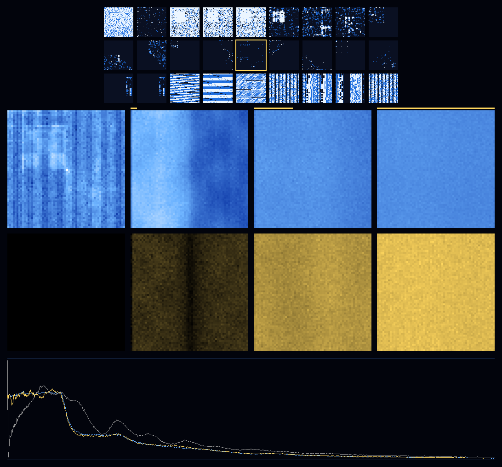

# Mixed GGUFs as the neural network: Asolaria Herself as the trits

The 27 Asolaria GGUFs become the trits of the nested ternary network from
[Neural-network-inside-a-neural-network-using-trits-to-resolve-Finiteness](https://github.com/JesseBrown1980/Neural-network-inside-a-neural-network-using-trits-to-resolve-Finiteness),
one GGUF per D3Q27 channel, with `ASOLARIA-HERSELF.gguf` on the rest channel. The
network is put into a Taylor–Green vortex and pushed by a solar wind for 576
ticks. Two copies run in lockstep, one with the wind and one without.

Rust 1.81 with clippy (`-D warnings`), integer only, no `f32`/`f64`, no JSON, no
Node. Receipts are HBP/HBI with SHA-256, and every receipt line ends in `json=0`.

Predictions were sealed in [`PREREG.hbp`](PREREG.hbp) (sha256 `30201902…`) and
pushed in commit `2bcc7b2` before any run code was written.



**Figure.**
- **Top:** the 27 channels at layer z = 32 (dark = 0, blue = 1, white = 2).
  Asolaria Herself is the gold-framed rest channel.
- **Middle:** the Asolaria lattice with the wind on, at t = 0, 32, 192 and 576.
  The upper row is density summed over z; the lower row is the wind-on minus
  wind-off x-momentum (gold = pushed toward +x).
- **Bottom:** solar-wind intake per tick for Asolaria (gold), shuffled (blue) and
  uniform (grey).

## 1. The network

| Level | What it is |
|---|---|
| Inner | 64 × 64 × 64 periodic cells; each cell has the 27 D3Q27 channels c ∈ {−1, 0, 1}³; 7,077,888 trits |
| Channels | one GGUF per channel; `ASOLARIA-HERSELF.gguf` holds c = (0, 0, 0); the other 26 fill the moving channels in commit order ([`results/CHANNELS.hbp`](results/CHANNELS.hbp)) |
| Gates | 288 four-channel involutive gates, 32 per cell per tick; byte-identical to the repository's C++ construction with the Taylor–Green pairing rule (gate table sha256 `a7fca71a…`, checked in `tests/`) |
| Outer | the 27 channel masses are the 27 shell modes; their sum Q is the conserved mass |

**GGUF → trits** ([`src/field.rs`](src/field.rs)).
- *Magnitude:* F32 values are read as their raw bits with the sign bit cleared,
  which orders exactly like |v|. Int8 values are read as unsigned bytes.
- *Layout:* a file with 64³ tensors contributes their per-cell maximum. A file
  with 64 × 64 slices stacks them on z. Any other file has all its elements tiled
  in file order.
- *Trit:* 0 for zero, 1 up to the lower median of that file's non-zero
  magnitudes, 2 above it.
- *Cross-check:* the lattice sha256 `2cc5af44…` is reproduced exactly by a
  separate Python build.

**Inputs.** The 27 GGUFs are every GGUF with bytes in
`ASOLARIA-UNIVERSE-SIMULATOR…` (22) and `FOLLOW-THE-IS-NOT-THE-WILL-AND-WAS` (5).
[`data/MANIFEST.hbp`](data/MANIFEST.hbp) gives each file's source path, commit
time, byte count and sha256; all 27 match their sidecars. Kimi K3 Star
(202,115,456 bytes) and the three pumped spheres are held in Git LFS and were not
available to this run.

**Taylor–Green.** u_x ∝ sin x cos y cos z and u_y ∝ −cos x sin y cos z, taken as
signs (the square wave) from the cell index alone. Each x- and y-mirror channel
pair moves one trit toward the local flow sign. Mass and 2E are unchanged.

**Solar wind.** Every tick, on the plane x = 0, each of the 9 x-mirror pairs moves
one trit from −x to +x where it can. Each move adds 2 to px. Mass, 2E, py and pz
are unchanged.

**Controls.**
- *Shuffled:* each channel's cells permuted by an integer Fisher–Yates; same trit
  counts, no arrangement.
- *Uniform:* every slot 1.

## 2. Results

All numbers are from [`results/RESULT.hbp`](results/RESULT.hbp) and
[`results/SERIES.hbp`](results/SERIES.hbp).

### Pre-registered verdicts

| ID | Prediction | Measured | Verdict |
|---|---|---|---|
| P1 | mass, 2E, py, pz exact every tick; px(off) constant; px(on) = px₀ + injected | asserted on all 576 ticks of all 6 runs | **PASS** |
| P2 | z: the global sha256 of the wind-on state differs from wind-off at t = 1 | t = 1 on all three lattices | **PASS** |
| P3 | c: the front never passes distance t; the x = 32 plane's local hash first changes at t = 32 | front = 1, 2, 3 … 32 at t = 1 … 32; x = 32 changes at t = 32, all three | **PASS** |
| P4 | 72 ticks forward, 72 back restores every trit | 3,709,609 slots moved at t = 72, all 7,077,888 restored | **PASS** |
| P5 | uniform all-ones lattice unchanged after 72 ticks | unchanged | **PASS** |
| P6 (operator) | the lattice absorbs the wind push | all 3,448,220 injected px retained; 73.6% carried beyond 8 planes of the inflow; intake 1,558,500 in the first 64 ticks, 52,364 in the last 64 | **HELD**; the intake fell 29.8× as the lattice filled |
| P6b | intake declines from the first 64 ticks to the last 64 | declined on all three lattices | **PASS** |
| P7 | Asolaria and shuffled total injected px within 5% | 3,448,220 vs 3,470,900, a 0.66% difference | **PASS** |
| P8 | at t = 10¹³: mass, 2E, py, pz exact; mean intake ≤ the px bound over t | see §2.4 | **PASS** |

### 2.1 z and c

| Lattice | Global sha256 differs | Front reaches x = 32 | Plane x = 32 local hash differs |
|---|---|---|---|
| Asolaria | t = 1 | t = 32 | t = 32 |
| Shuffled | t = 1 | t = 32 | t = 32 |
| Uniform | t = 1 | t = 32 | t = 32 |

The whole-lattice hash changes on the first tick, z. A local observer at
distance 32 sees nothing until t = 32, which is c = 1 exactly. This is the
`zlight` result of the HEB-C repository, now on a 27-GGUF fluid lattice.

### 2.2 The wind

| Lattice | Intake, first 64 ticks | Intake, last 64 ticks | Total intake | Carried beyond 8 planes |
|---|---:|---:|---:|---:|
| Asolaria | 1,558,500 | 52,364 | 3,448,220 | 73.6% |
| Shuffled | 1,580,074 | 51,220 | 3,470,900 | 73.6% |
| Uniform | 1,346,578 | 74,522 | 4,136,262 | 73.4% |

**Asolaria intake per tick:**

| t | 1 | 56 | 64 | 72 | 80 | 128 | 256 | 512 | 576 |
|---|---|---|---|---|---|---|---|---|---|
| intake | 23,950 | 26,054 | 25,238 | 15,804 | 10,586 | 9,688 | 3,158 | 916 | 732 |

The intake holds until t = 64, one full lap of the 64-wide torus at c = 1, and
falls once the pushed momentum comes back around to the inflow plane. By t = 576
the pushed x-momentum is spread almost evenly over all 64 planes (the
`delta_px_by_plane` row of `WIND`).

### 2.3 The vortex

Enstrophy is in integer units of |2 curl j|², from central differences.

| Lattice | Start | t = 576, wind off | t = 576, wind on |
|---|---:|---:|---:|
| Asolaria | 15,553,212 | 30,742,426 | 13,870,312 |
| Shuffled | 18,586,080 | 30,940,304 | 13,734,328 |
| Uniform | 48,070,656 | 37,743,994 | 14,097,560 |

- **GGUF lattices:** without wind, the Taylor–Green enstrophy roughly doubles as
  the GGUF structure relaxes into motion.
- **Uniform lattice:** it decays.
- **With wind:** all three end within 3% of each other, about 55% below the
  Asolaria wind-off value.

### 2.4 The jump to 10¹³ ticks

What is exact at t = 10,000,000,000,000 without running it:

| Quantity | Value at t = 10¹³ | Why |
|---|---|---|
| mass, 2E, py, pz | 4,059,952; 9,164,502; −92,664; 567,020 | every gate and every streaming step conserves them, wind on or off |
| px, wind off | −38,720 | conserved |
| free-streaming state | identical to the start | free streaming returns exactly after 64 ticks, and 64 divides 10¹³ |
| mean wind intake per tick | ≤ 4,757,312 / 10¹³ | px can never exceed 2 × 9 × 262,144 = 4,718,592 |
| outer recurrence Q mod P, ν = 1 | 288,531 | Q(u_t) + t·ν·D ≡ Q(u₀) mod 1,000,081, D = 883,973 |

The gated microstate at 10¹³ is not reachable by a shortcut. The gate schedule
repeats every 9 ticks and free streaming every 64, but their composition has no
known short period, so the state must be run tick by tick. The bound on px makes
the absorption finite: over 10¹³ ticks the lattice can take in, on average, less
than one millionth of a unit of momentum per tick.

## 3. Reproduce

```sh
cargo clippy --release --all-targets -- -D warnings
cargo test --release
cargo run --release -- all data out 576
cd out && sha256sum -c ../results/SHA256SUMS
```

The run takes about 8½ minutes on one core. CI ([`.github/workflows/ci.yml`](.github/workflows/ci.yml))
installs Rust 1.81.0 and then:
- fails on any `f32`/`f64`, JSON, JS or Node file;
- runs clippy and the tests;
- checks the 27 GGUF inputs against the manifest;
- reruns the full experiment and checks every output against the committed
  `results/SHA256SUMS`.

| Path | Contents |
|---|---|
| `PREREG.hbp` | the sealed predictions |
| `data/` | the 27 GGUFs and `MANIFEST.hbp` |
| `src/gguf.rs` | GGUF v3 reader, integer magnitudes |
| `src/field.rs` | GGUF → 64³ trits |
| `src/lattice.rs` | D3Q27 gates, streaming, inverse |
| `src/physics.rs` | Taylor–Green, solar wind, enstrophy, front, hashes |
| `src/sha256.rs`, `src/hbp.rs`, `src/png.rs` | SHA-256, HBP/HBI receipts, integer PNG writer |
| `src/main.rs` | the experiment |
| `tests/integer_network.rs` | SHA-256 vectors, the gate-table hash, GGUF reading, conservation |
| `results/` | `RESULT.hbp`, `SERIES.hbp` (every 8 ticks, all 27 outer modes), `CHANNELS.hbp`, `INDEX.hbi`, `SHA256SUMS`, `lattice.trits`, `figure.png` |

Operator: Jesse Daniel Brown.
